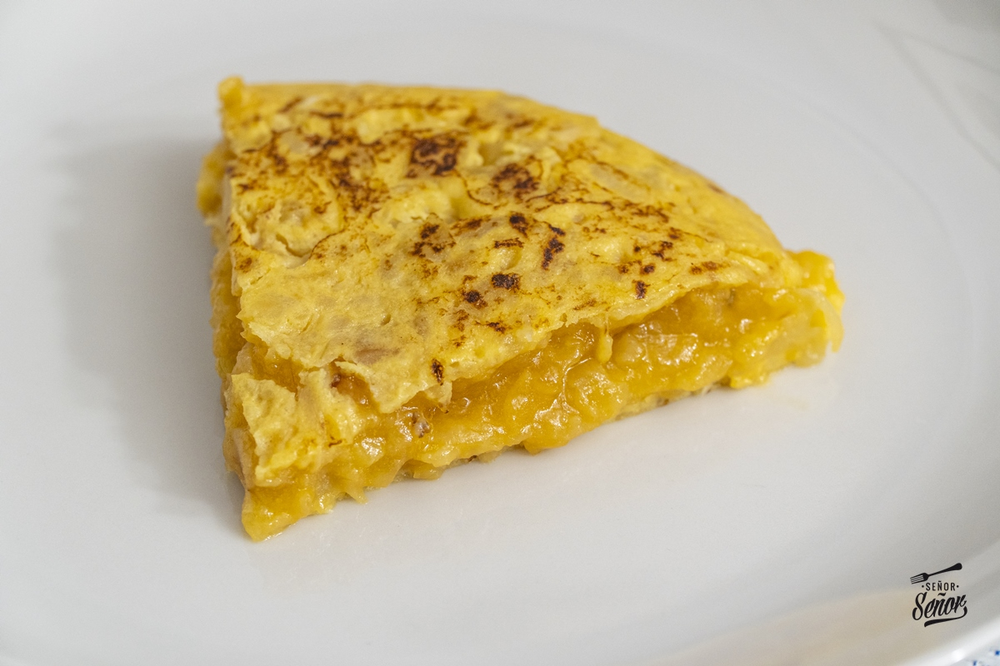

# Tortilla con cebola

## Ingredientes

| Ingredientes | Cantidade |
| --- | --- |
| Patatas grandes | 4 |
| Cebola grande | 1 |
| Ovos camperos | 6 |

## Modo de realización

1. Cortar e pochar

1. Pela e curta as patacas en láminas finas e irregulares. Curta a cebola á xuliana fina.
2. Frite a lume lento: Pon abundante aceite de oliva nunha tixola fonda. Engade a pataca e a cebola xuntas cun toque de sal. Cociña a lume medio-baixo durante uns 20-25 minutos, removendo de cando en vez, ata que a pataca estea tenra e a cebola lixeiramente caramelizada (deben confeitarse, non renxer).
3. Escorre: Saca as patacas e a cebola da tixola cunha espumadera para eliminar todo o exceso de aceite.

2. Mesturar e repousar

1. Bate os ovos nun bol grande cun belisco de sal ata que queden espumosos.
2. Integra: Engade a pataca e a cebola escorridas ao bol co ovo batido.
3. O segredo: Deixa repousar a mestura durante 5 minutos. Isto permite que a pataca absorba o ovo e a tortilla quede incriblemente zumenta.

3. Callar e dar a volta

1. Quenta a tixola: Pon unha tixola antiadherente a lume medio-alto cunha cucharadita do aceite que che sobrou de fritir.
2. Verte a mestura e móvea un pouco en círculos ao principio para que empece a callar de xeito uniforme. Cociña durante uns 2-3 minutos a lume medio.
3. Dá a volta: Coloca un prato chairo (máis grande que a tixola) encima. Cun movemento firme e rápido, dálle a volta á tixola. Desliza a tortilla de novo na tixola para callar o outro lado durante 1-2 minutos (menos tempo se che gusta moi líquida por dentro).